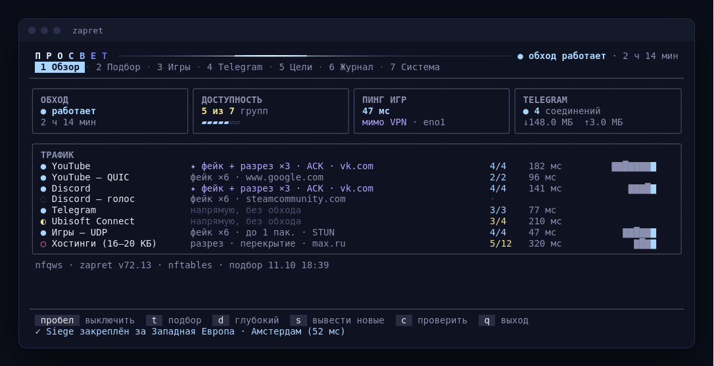

<p align="center">
  <picture>
    <source media="(prefers-color-scheme: dark)" srcset="docs/banner-dark.svg">
    
  </picture>
</p>

<p align="center">
  <a href="https://github.com/FrainTX/zapret/releases/latest"></a>
  
  <a href="LICENSE"></a>
</p>

<p align="center">
  Обход блокировок и минимальный пинг в играх.<br>
  Сам подбирает стратегию под провайдера, сам чинит её и сам обновляется.
</p>

<p align="center"></p>

## Установка

**Windows** — скачайте `prosvet-…-windows-amd64.zip` из [релиза](https://github.com/FrainTX/zapret/releases/latest), распакуйте, откройте `zapret.bat`.

**Linux** — скачайте `prosvet-…-linux-amd64.tar.gz`, распакуйте и выполните:

```bash
./install.sh
```

Дальше панель открывается командой `zapret` из любой папки.

## Что умеет

| | |
|---|---|
| **YouTube, Discord, сайты** | подбирает рабочий рецепт для каждой группы трафика, а если готовых не хватает — выводит новые |
| **Telegram** | встроенный прокси через WebSocket: стикеры и медиа без VPN |
| **Rainbow Six Siege, For Honor** | игровой трафик мимо VPN, ближайший дата-центр Siege, обход трогает только первые пакеты |
| **Самовосстановление** | проверяет цели и переподбирает только то, что сломалось |
| **Обновления** | ставит новые версии сам, каждая проверяется цифровой подписью |
| **Linux и Windows** | systemd, OpenRC, runit, dinit, SysV · nftables или iptables · Windows 10/11 |

<details>
<summary><b>Чем отличается от zapret-discord-youtube</b></summary>

<br>

| | Flowseal | Просвет |
|---|---|---|
| Стратегия | 22 готовых `.bat`, перебирать вручную | автоподбор по группам, лучшая для каждой |
| Новые стратегии | только из архива | селекция: рецепты скрещиваются и мутируют, лучшие сохраняются |
| Работает без обхода | всё равно гоняет через фейки | сначала проверка, работающее не трогаем |
| Фейки | фиксированные `.bin` | генерируются для любого имени: TLS ClientHello Chrome, QUIC Initial по RFC 9001 |
| Telegram | отдельный проект | встроен, без прав администратора |
| Игры | весь UDP через WinDivert, ×12 фейков | только игровые подсети, первые пакеты, мимо VPN, ближайший дата-центр |
| Linux | нет | все популярные дистрибутивы и init-системы |
| Обновления | вручную | автоматически, с проверкой подписи |

</details>

<details>
<summary><b>Как работает подбор</b></summary>

<br>

1. **Без обхода.** Каждая цель проверяется напрямую — работающее не трогаем.
2. **Рецепты.** 30+ рецептов zapret и выведенные на прошлых подборах. Группы проверяются одновременно, каждая в своём профиле.
3. **Приманки.** Для лучших рецептов перебираются имена из белого списка ТСПУ.
4. **Селекция.** Рабочие рецепты раскладываются на «гены» — способ разреза, отсев фейков, приманка, повторы — и скрещиваются. Каждый потомок проверяется настоящим движком.
5. **Универсальный рецепт.** Ищется один рецепт, который работает для всех групп не хуже их собственных.
6. **Проверка.** Итоговая связка прогоняется дважды, нестабильный рецепт заменяется.

Если включён VPN, проверки идут мимо него — рецепты подбираются под настоящий DPI вашего провайдера.

</details>

<details>
<summary><b>Игры: минимальный пинг</b></summary>

<br>

- **Мимо VPN.** Если включён VPN (Happ, v2rayN, Hiddify, AmneziaWG, WireGuard…), игровой UDP на Linux идёт напрямую через основной шлюз — на тестовой машине 274 → 47 мс до AWS Франкфурт. На Windows панель подскажет, какие `.exe` добавить в исключения VPN.
- **Ближайший дата-центр Siege.** `zapret games` меряет 13 регионов, `zapret games pin` закрепляет лучший в `GameSettings.ini` (с резервной копией).
- **Минимум вмешательства.** Движок обрабатывает только первые пакеты потока; среди одинаково рабочих рецептов выигрывает тот, что быстрее и шлёт меньше лишних пакетов.

</details>

<details>
<summary><b>Telegram</b></summary>

<br>

Telegram Desktop подключается к прокси на `127.0.0.1:1443`, а прокси ведёт трафик к серверам Telegram через WebSocket, как web.telegram.org. Маршруты пробуются и через VPN, и напрямую, лучший выбирается сам. Ссылка для подключения — во вкладке «Telegram» панели или командой `zapret telegram`.

</details>

<details>
<summary><b>Обновления</b></summary>

<br>

Служба проверяет релизы каждые 6 часов и ставит новую версию сама. Архив сверяется с `SHA256SUMS`, а сам список — с подписью ed25519, ключ которой встроен в программу: подменённый релиз не установится, даже если кто-то получит доступ к репозиторию.

`zapret update` — обновиться сейчас · `--auto off` — выключить автообновление · `--mirror https://…` — своё зеркало.

</details>

<details>
<summary><b>Команды</b></summary>

<br>

```
zapret                      панель
zapret status               состояние
zapret tune [--deep]        автоподбор
zapret start | stop         включить / выключить
zapret check                проверить доступность
zapret games [pin|restore]  пинг до дата-центров, закрепить Siege
zapret telegram             прокси для Telegram Desktop
zapret enable | disable <цель>   youtube discord telegram r6 forhonor cloud sites
zapret domains add <домен>  свой сайт в обход
zapret update               обновиться
zapret install | uninstall
```

</details>

<details>
<summary><b>Сборка и устройство</b></summary>

<br>

```bash
scripts/build.sh
```

Go скачается сам. Всё собирается без cgo, Windows — кросс-компиляцией. Выпуск версии: `scripts/release.sh 1.0.1`, остальное делает GitHub Actions.

```
cmd/prosvet         программа: панель, команды, служба
internal/tui        панель (Bubble Tea, Lip Gloss)
internal/strategy   группы, рецепты, селекция, валидатор
internal/tuner      автоподбор
internal/tgproxy    Telegram через WebSocket
internal/games      пинг до дата-центров, настройки Siege
internal/netroute   определение VPN и шлюза
internal/firewall   nftables / iptables, маршрут игр мимо VPN
internal/update     подписанные обновления
internal/engine     встроенный zapret
```

</details>

## Благодарности

[bol-van/zapret](https://github.com/bol-van/zapret) — движок · [Flowseal/zapret-discord-youtube](https://github.com/Flowseal/zapret-discord-youtube) — списки и опыт стратегий · [Flowseal/tg-ws-proxy](https://github.com/Flowseal/tg-ws-proxy) — идея Telegram через WebSocket · [hyperion-cs/dpi-checkers](https://github.com/hyperion-cs/dpi-checkers) — методика «16–20 КБ»
